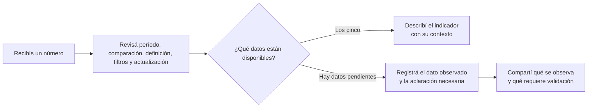
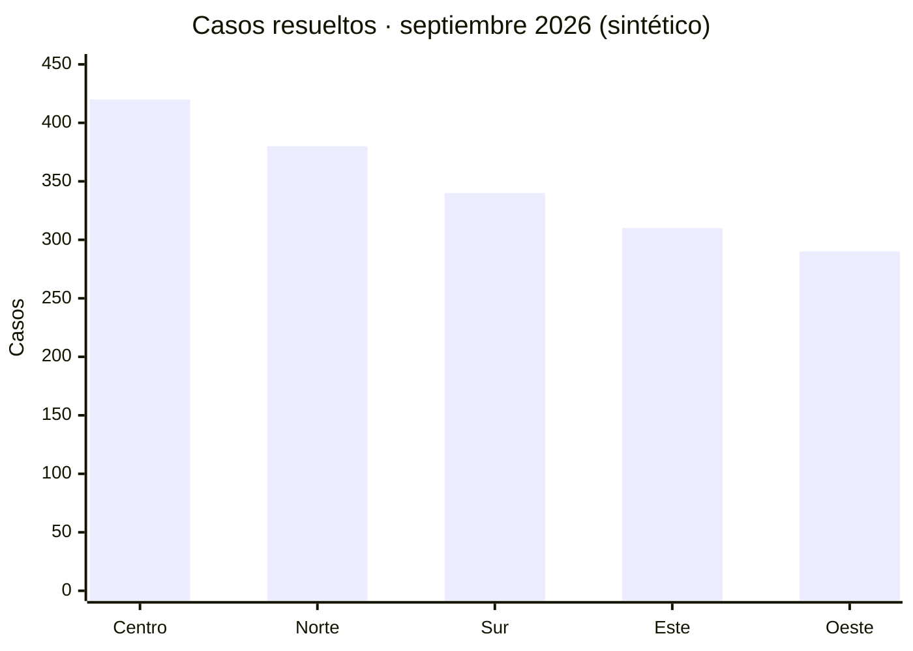
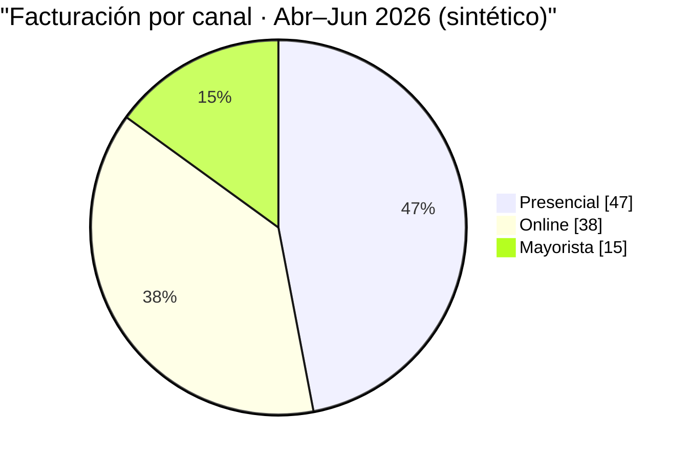
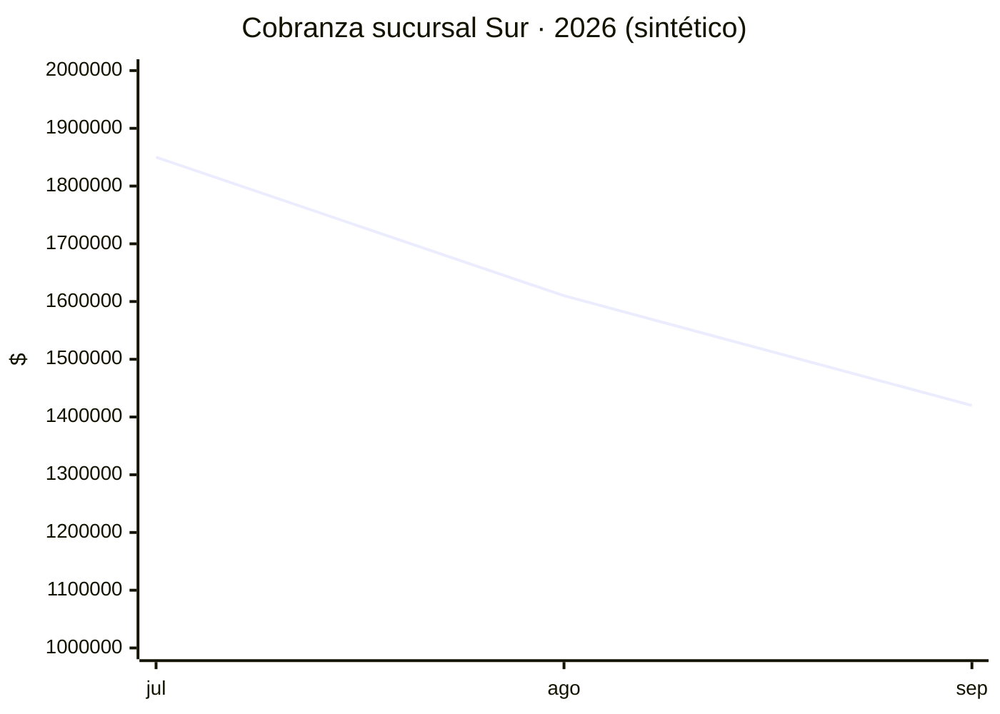
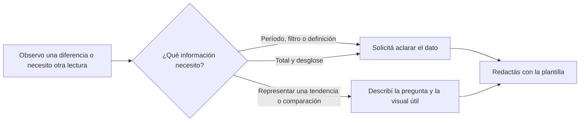
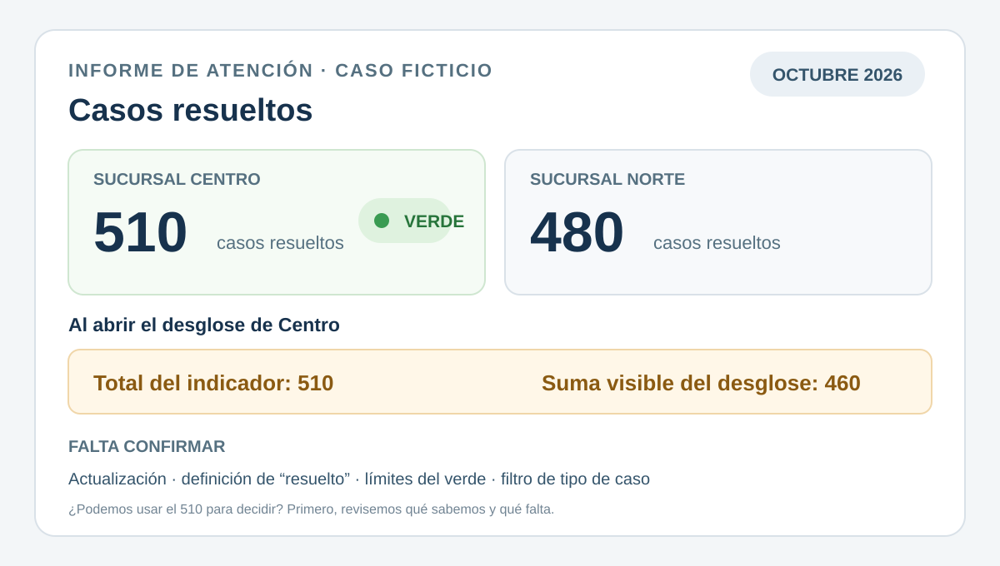

# Jornada 2 · Leer e interpretar indicadores en Excel y Power BI

**Docente:** Inti  
**Carga:** 2 horas · virtual sincrónica

---

## Propósito y resultados de aprendizaje

En esta jornada vas a practicar la lectura de tableros de Power BI y planillas de Excel que ya están disponibles. El foco está en entender qué muestra un indicador, qué contexto necesitás para interpretarlo y cómo pedir una aclaración de forma concreta.

Al finalizar, vas a poder:

- describir un indicador con su período, comparación, definición, filtros y fecha de actualización;
- distinguir entre lo que el tablero muestra y lo que podés concluir con esos datos;
- usar filtros y desgloses para observar la información;
- pedir un dato, una definición o una mejora de visualización con un mensaje claro.

Esta jornada es solo de lectura: no vamos a construir tableros ni a usar fórmulas, DAX o tablas dinámicas. Eso corresponde a otros espacios. La decisión operativa sigue en manos de cada responsable, con información suficiente y validada.

### Cómo usar este material según tu experiencia

Empezamos por lo básico y avanzamos hacia su uso en decisiones de gestión. Podés vincular el caso común con los indicadores de tu propia función.

- **Si es tu primer acercamiento:** seguí las preguntas en orden y usá los ejemplos guiados para identificar cada parte del contexto.
- **Si ya tenés experiencia:** además de completar la lectura, preguntate qué otra información te permitiría comparar explicaciones posibles.
- **Si no tenés a mano el tablero de tu área:** trabajá con el caso sintético de esta jornada; tiene todos los datos necesarios para practicar.

Todos los ejemplos son ficticios y sirven para practicar. En clase, usá datos generales o anonimizados; así cuidamos la información de personas, clientes y operaciones.

---

## Idea principal: primero leer, después opinar

Un gráfico ordena datos para responder una pregunta. Antes de opinar sobre un número, buscá estos cinco datos: **período, comparación, definición, filtros y fecha de actualización**. Con eso podés decir qué muestra el número, qué no muestra y qué te falta preguntar.

---

## Por qué usamos gráficos para resumir información

Los gráficos ayudan a ver diferencias, proporciones y cambios en el tiempo. Pero cada gráfico se construyó con decisiones: qué categorías mostrar, cómo se definió el indicador, qué escala se usó y qué período se eligió. Si conocés esas decisiones, leés el gráfico con más precisión.

Algunos hitos muestran cómo se amplió el uso de los gráficos:

| Año | Hito en los gráficos para decidir |
| --- | --- |
| **1786** | Playfair inventa la gráfica de barras y la de línea. |
| **1801** | Publica el primer gráfico circular (*pie*). |
| **1858** | Florence Nightingale usa diagramas de rosas para cambiar una política sanitaria. |
| **1970** | Las planillas electrónicas hacen más accesible organizar tablas y generar gráficos en computadoras personales. |
| **2000s** | Los tableros (*dashboards*) reúnen indicadores que pueden actualizarse con una frecuencia definida. |
| **2015** | Microsoft presenta Power BI como producto independiente para crear y compartir análisis interactivos. |

Dos ideas para llevarte de esta jornada:

- **Todo gráfico es una decisión.** La escala, las categorías y el período definen qué se ve y qué queda oculto. Mirá esos elementos junto con el título y la fuente.
- **La herramienta dibuja; el contexto explica.** Un buen gráfico muestra unidades, períodos y categorías a la vista, y cada indicador necesita una definición que diga qué datos incluye.

---

## Qué es Power BI

Power BI es una herramienta de Microsoft para ver y explorar información en informes interactivos. Un informe reúne páginas, indicadores y gráficos conectados a distintas fuentes de datos. En esta jornada vas a leer informes ya publicados y a practicar cómo pedir lo que necesites a quien los administra.

Un informe te permite:

- ver datos que vienen de bases, planillas y servicios,
- cambiar el recorte con filtros en pantalla, por ejemplo por sucursal, canal o período (en Power BI se llaman *segmentadores* o *slicers*),
- ver la misma medición en distintos gráficos (columnas, torta, línea, semáforo),
- consultar la información y los filtros disponibles sin modificar el informe.

El camino de la información es así: **fuentes → definiciones → informe → tu lectura con filtros**. El informe también puede decir cuándo se actualizaron los datos. Ojo: la fecha de actualización no es lo mismo que el período. Por ejemplo, un informe actualizado el 12 de octubre puede mostrar datos de septiembre.

**Vocabulario de trabajo:**

- **Informe o tablero:** conjunto de páginas con indicadores y gráficos.
- **Gráfico o visual:** cada representación individual, como una tarjeta, una serie de columnas, una línea o un semáforo.
- **Filtro o segmentador:** control que limita la información visible, por ejemplo a una sucursal.
- **Fecha de actualización:** fecha y, a veces, hora de la última carga de datos disponible en el informe.
- **Período:** intervalo al que corresponden los datos mostrados.

---

## Los 5 datos que necesitás para leer un indicador

Antes de usar un número para explicar algo o decidir, buscá estos cinco datos. Anotá lo que veas y, si algo no aparece, anotalo como pregunta pendiente.

- **Período.** ¿De cuándo son los datos? ¿Septiembre cerrado, octubre hasta hoy, acumulado del año, últimos 30 días? Ojo: “octubre” puede ser el mes completo o solo lo que va del mes.
- **Comparación.** ¿Contra qué lo comparás? ¿Mes anterior, mismo mes del año pasado, meta, promedio u otra sucursal? Sin referencia solo describís el número; con referencia podés decir si subió, bajó o está dentro de lo esperado.
- **Definición.** ¿Qué cuenta el indicador y qué deja afuera? Por ejemplo, “casos resueltos” puede ser los cerrados en el período o todos los que hoy figuran como resueltos. No son lo mismo.
- **Filtros.** ¿Qué está seleccionado? ¿Qué sucursal, canal, tipo de caso, estado? “Todos” significa todo lo disponible; cualquier otra opción recorta los datos.
- **Fecha de actualización.** ¿Cuándo se cargaron los datos? Comparala con el período: así sabés si ya cerró el mes o si todavía pueden entrar registros.

Con estos cinco datos podés contar qué muestra el indicador. Si algo te falta, presentá tu lectura como provisoria y decí qué necesitás confirmar. Separá siempre lo que ves de lo que suponés.



> **Regla de oro:** contá lo que ves junto con sus 5 datos. Si algo te falta, decí que es una lectura provisoria y preguntá justo eso que falta.

---

## Los 4 gráficos más comunes

Cada pregunta pide un gráfico distinto. Las columnas comparan categorías, la torta muestra cómo se reparte un total, la línea muestra cambios en el tiempo y el semáforo dice en qué rango está un valor. Sirven igual en Excel y en Power BI. En todos los casos, empezá por lo mismo: título, unidades, período y filtros.

### Columnas

**Para qué sirve:** comparar valores entre categorías del mismo período, por ejemplo entre sucursales, canales o equipos.
**Usalo cuando:** hay pocas categorías y querés ver cuál es mayor o menor.
**Qué mirar:** título, unidad, período y desde dónde empieza el eje vertical. Si el eje no empieza en cero, una diferencia chica puede parecer grande: mirá los números, no solo las alturas.

**Ejemplo** (datos ficticios):
En septiembre, Centro tiene 420 casos, Norte 380, Sur 340, Este 310 y Oeste 290. El filtro incluye todos los tipos de caso y los datos son al 12 de octubre. Lectura correcta: “En septiembre, Centro tuvo el mayor volumen, con 420 casos resueltos entre consultas y reclamos”. Para decir si eso es un buen desempeño, te falta una meta y una definición común de “resuelto”.



**Cómo leerlo en 3 pasos:**
1. Leé título y período: ¿qué muestra cada columna?
2. Mirá unidad, escala y filtros; después compará los números.
3. Decilo en una frase (“Centro tuvo 420, el valor más alto”). Si querés hablar de desempeño, sumá una meta o comparación.

### Torta

**Para qué sirve:** ver cómo se reparte un total entre pocas categorías.
**Usala cuando:** la pregunta es qué parte le toca a cada uno.
**Qué mirar:** a qué total corresponde el 100 %, de qué período es y qué filtros tiene. Si filtrás por una sucursal, el 100 % es solo esa sucursal.

**Ejemplo** (datos ficticios):
Facturación de abril a junio de 2026: presencial 47 %, online 38 % y mayorista 15 %. Datos al 5 de julio. Lectura correcta: “El canal presencial concentró la mayor parte de la facturación del trimestre”. Decir si el 38 % de online es alto o bajo exige compararlo con una meta u otro período.



**Cómo leerla en 3 pasos:**
1. Fijate qué categorías forman la torta y a qué total corresponde el 100 %.
2. Leé los porcentajes y ubicá la parte más grande.
3. Para decir si es alta o baja, comparala con una meta u otro período.

### Línea

**Para qué sirve:** ver cómo cambia un indicador a lo largo del tiempo.
**Usala cuando:** querés detectar una tendencia mes a mes, semana a semana o día a día.
**Qué mirar:** que las fechas estén en orden, cuánto dura cada período, la unidad y la leyenda si hay varias líneas. Si la escala vertical está recortada, los cambios parecen más bruscos: leé los valores.

**Ejemplo** (sintético):
Cobranza de la sucursal Sur: $1.850.000 en julio, $1.610.000 en agosto y $1.420.000 en septiembre de 2026. Datos al 18 de octubre. Lectura correcta: “La cobranza de Sur bajó los tres meses seguidos”. Para buscar por qué, pedí un desglose por canal o por cantidad de operaciones.



**Cómo leerla en 3 pasos:**
1. Leé las fechas de izquierda a derecha y seguí la línea.
2. Describí el movimiento con los valores de los extremos: acá, baja de $1.850.000 a $1.420.000.
3. Fijate cuál es el último período mostrado. Para explicar el cambio, pedí un desglose (canal, cantidad de operaciones).

### Semáforo

**Para qué sirve:** ver en qué rango está un valor: dentro de lo esperado, cerca del límite o fuera de rango.
**Usalo cuando:** los límites de cada color están acordados y a la vista.
**Qué mirar:** período, unidad, valor medido y límites vigentes. Sin límites, el color no dice nada.

**Ejemplo** (sintético):
“Tiempo promedio de respuesta” de la sucursal Norte: 47 minutos, en amarillo. Corresponde a octubre hasta el 20/10/2026 a las 09:15 y cuenta casos cerrados. El amarillo va de 30 a 60 minutos. Lectura correcta: “El promedio está dentro del rango amarillo definido”. Antes de evaluar el desempeño, confirmá que esos límites sigan vigentes y qué casos incluye la cuenta.

El color resume una **comparación entre el valor y los límites configurados**. Leé la leyenda del semáforo junto con el indicador:

```
        Umbral (min)
Verde   < 30        ✅
Amarillo 30 – 60    ⚠️  ← Norte está acá: 47 min
Rojo    > 60        🔴
```

> **Con el semáforo:** ubicá el valor en su rango y verificá período y vigencia de los límites. Si el informe no muestra los límites, pedilos: sin ellos no se puede interpretar el color.

### Qué gráfico conviene según tu pregunta

| Pregunta | Gráfico útil | Qué mirar |
| --- | --- | --- |
| ¿Cuánto vale cada categoría? | Columnas | Escala, unidades y período |
| ¿Qué parte del total le toca a cada uno? | Torta, con pocas partes | A qué total corresponde el 100 % |
| ¿Cómo cambió en el tiempo? | Línea | Orden y duración de los períodos |
| ¿Estoy dentro de lo esperado? | Semáforo con límites a la vista | Valor, límites y vigencia |
| ¿Cuál es el valor exacto? | Tarjeta o tabla | Unidad, período y redondeo |

Una tarjeta muestra un solo número bien grande. Para leerla, sumale unidad, período, definición, filtros y fecha de actualización.

### Mini-práctica · Elegí el gráfico

Para cada pregunta, decí en voz alta qué gráfico usarías y qué dato verificarías:

| # | Pregunta | ¿Qué gráfico usarías? | ¿Qué verificarías? |
| --- | --- | --- | --- |
| 1 | ¿Cómo evolucionó mi facturación mes a mes este año? | | |
| 2 | ¿Qué porcentaje del total vende cada canal? | | |
| 3 | ¿Qué sucursal tuvo más reclamos en el mes? | | |
| 4 | ¿Estoy dentro de la meta del trimestre? | | |

> **Pista:** partí de la pregunta y usá la tabla de arriba. Después nombrá un solo dato que te dé contexto.

---

## Cómo moverte en un informe sin perderte

Para leer con claridad, anotá siempre tres cosas: en qué página estás, qué indicador mirás y qué filtros tiene.

1. **Ubicá página e indicador.** Leé el título de la página, el título del gráfico y las unidades. Anotá el nombre del informe para volver después.
2. **Mirá los filtros.** Revisá los controles de arriba o del costado. Anotá qué está seleccionado. Si cambiás un filtro, anotá el nuevo recorte y fijate cómo cambian los números.
3. **Precisá el período.** Buscá el selector de fechas: ¿es un mes cerrado, el mes en curso o un rango a medida? “Octubre” y “octubre hasta hoy” no son lo mismo.
4. **Abrí el desglose.** Si podés hacer clic en una categoría o abrir un detalle, compará el total con la suma de las partes. Anotá qué filtro tiene cada vista.
5. **Buscá la actualización.** Encontrá la fecha de actualización en la página o en la info del informe. Anotala junto al período: responden preguntas distintas.

### Si el total y el desglose no coinciden

Anotá los dos números, el período y los filtros de cada vista. Por ejemplo: “Total: 510; desglose: 460; octubre; tipo de caso: todos”. Con eso, quien administra el informe puede revisar si usan la misma definición y los mismos filtros. Vos no cambies nada del informe publicado: solo describí lo que ves.

### Lo mismo en una planilla de Excel

Usá las mismas preguntas en una planilla compartida:

- **Hoja y título:** fijate que estés en la hoja del indicador y período que necesitás.
- **Filtros y filas:** mirá qué filtros están activos y si hay filas ocultas. Anotá qué recorte estás viendo.
- **Período y actualización:** buscá fechas en el título, los encabezados o alguna nota. Si no hay fecha, anotá “actualización no indicada”.
- **Gráfico y unidades:** fijate si el gráfico responde a tu pregunta y revisá etiquetas y unidades.
- **Si las sumas no cierran:** anotá la celda, el total que ves, tu cálculo y los filtros activos. Pasale esos datos a quien administra la planilla.

Describir es tu tarea; cambiar fórmulas o estructura le toca a quien administra el archivo.

---

## Cuando algo no cierra: qué tipo de pregunta hacer

Contá qué diferencia viste y qué necesitás saber. Cuanto más concreta la pregunta, más rápido te pueden responder.

- **Dos informes dan distinto:** ¿usan el mismo período, la misma definición y los mismos filtros?
- **El tablero no coincide con lo que ves en la operación:** contá qué observaste y preguntá qué casos, estados o fechas incluye el indicador.
- **El desglose no suma igual que el total:** pasá los dos números con sus filtros y preguntá si usan las mismas reglas.
- **No te queda clara la definición:** preguntá qué incluye y qué deja afuera.
- **El gráfico no te sirve para tu pregunta:** contá qué necesitás responder y sugerí otro gráfico. Por ejemplo, una línea para ver una tendencia.



**Antes de preguntar, chequeá esto:**

- ¿El período es el que yo creo?
- ¿La definición es la de mi área o es otra?
- ¿Qué filtros tiene cada vista?
- ¿Cuándo se actualizaron los datos y de qué período son?
- ¿Mi comparación usa el mismo período y la misma definición?
- ¿El desglose usa las mismas categorías que el total?

Tu parte es contar el contexto, qué viste distinto y qué necesitás saber. Con eso, quien administra el informe puede revisar fuentes, definiciones o filtros. Abajo tenés una plantilla para ordenar el pedido.

---

## Cómo pedir un dato a Sistemas (con plantilla)

Un buen pedido dice dónde miraste, qué número viste y qué pregunta tenés. Así la otra persona puede reproducir tu lectura y responderte justo eso.

**Copiá y completá:**

- Tablero o planilla, pantalla u hoja:
- Número que miro:
- Período:
- Filtros que veo:
- Actualización indicada (o “no indicada”):
- Qué me llama la atención o qué necesito decidir:
- Lo que pregunto (una sola cosa: período, filtro, definición, actualización u otro dato):
- Si pido otro gráfico: qué pregunta quiero responder y qué gráfico ayudaría:
- Para qué decisión lo necesito:

Cambiar un filtro para mirar un recorte es lectura personal. Si pedís un cambio permanente en el informe, contá qué pregunta de gestión tiene que responder.

### Ejemplo de pedido bien hecho

- Tablero: Cobranza, resumen mensual.
- Número: total cobrado de septiembre, sucursal Norte.
- Período: septiembre 2026.
- Filtros: Estado = Cobrado.
- Actualización: 18/10/2026.
- Diferencia: el tablero dice $1.200.000 y el reporte de campo dice $1.450.000.
- Pregunto: ¿usan los mismos filtros de canal y la misma definición de “cobrado”?
- Lo necesito para: cerrar la proyección de octubre con un solo número.

Fijate: hay dos cifras, una dimensión a comparar (canal) y una definición a confirmar. Con la respuesta ya podés interpretar la diferencia antes de usar un número en la proyección.

---

## Indicadores y alertas: para qué sirve cada uno

Leer datos sirve para describir resultados y detectar cambios frente a un período anterior, un nivel habitual o una meta. Un semáforo resume eso en un color: compara el valor con rangos ya acordados.

Una **alerta** es un aviso de que se cumplió una condición, por ejemplo que el tiempo de respuesta superó el límite. Cuando te llega una, abrí el informe y revisá valor, período, definición y filtros antes de actuar. La alerta te orienta; la decisión la tomás vos con el contexto de tu rol.

Si querés proponer una alerta útil, contá: qué indicador seguir, en qué condición avisar, a quién avisarle y para qué decisión serviría. Quien administra los informes evalúa si se puede hacer y acuerda los límites con cada responsable.

---

## Caso guiado · Leamos juntos un indicador

Usemos este caso ficticio para practicar los 5 datos. No son resultados reales.



> Informe de atención, octubre de 2026: “casos resueltos” muestra 510 para Centro y 480 para Norte. Centro aparece en verde. Al abrir el desglose de Centro, las partes visibles suman 460. Todavía no sabemos la fecha de actualización, qué cuenta como “resuelto”, qué significa el verde ni qué filtro de tipo de caso está aplicado.

Respondé en voz alta o en el chat:

1. ¿De qué período son los datos y qué comparación podés hacer con lo que ves?
2. ¿Qué te falta saber para interpretar el número y el color verde?
3. En el desglose, ¿qué dos números compararías y qué filtros anotarías?
4. Escribí en una frase la pregunta que le harías a quien administra el informe.

<details>
<summary><b>Respuestas orientativas</b> (otras formulaciones valen si se apoyan en los datos)</summary>

1. **Período:** octubre de 2026. **Comparación:** Centro (510) vs. Norte (480), del mismo período.
2. **Falta:** fecha de actualización, definición de “resuelto”, filtros aplicados y qué rango es el verde. Si sirve a la gestión, se puede sumar una meta o el mismo mes del año pasado.
3. **Desglose:** total 510 vs. suma visible 460. Anotá qué categorías se ven y qué filtros tiene cada vista.
4. **Pregunta posible:** “¿El total y el desglose cuentan los mismos estados y tipos de caso? ¿Cuándo se actualizó el informe?”

</details>

### Para practicar en una línea

Respondé cada uno en una sola frase:

1. Una tarjeta dice “Cobranza: $8.000.000”. ¿Qué 5 datos anotarías para contarlo bien?
2. Una línea muestra las ventas de enero a diciembre. ¿Qué cambio ves y qué pedirías para explicarlo?
3. Una torta filtrada por sucursal Norte suma 100 %. ¿El 100 % de qué es?
4. Un semáforo está en rojo. ¿Qué valor, período y límites mirarías?
5. Un desglose suma distinto que el total. ¿Qué dos números y qué filtros pasarías en tu pregunta?

**Y un truco visual:** si el eje vertical no empieza en cero, las diferencias parecen más grandes. Mirá siempre los números de las etiquetas, no solo las alturas.

---

## Práctica en clase · Pedí un gráfico que te ayude

**Tiempo:** 15 minutos. **Modalidad:** individual o en parejas. La idea es practicar cómo explicar a Sistemas qué gráfico necesitás y para qué.

### Tu tarea

Pensá en una pregunta de gestión que te gustaría responder con un informe. Puede ser de tu función o una de estas:

- ¿Cómo cambió la cantidad de casos mes a mes?
- ¿Qué parte de las ventas corresponde a cada canal?
- ¿Qué sucursal recibió más reclamos?

Después, seguí estos pasos:

1. **Elegí la pregunta** que querés responder y el indicador que necesitás mirar.
2. **Proponé un gráfico** que ayude a responderla: línea para ver cambios en el tiempo, torta para repartir un total entre pocas categorías, columnas para comparar categorías.
3. **Usá la plantilla “Copiá y completá”** de la sección anterior para redactar el pedido a Sistemas. Indicá qué informe querés mejorar, qué pregunta necesitás responder, qué gráfico proponés y qué período o filtros deberían verse.

No hace falta explicar cómo construir el gráfico. Lo importante es que Sistemas entienda qué necesitás ver y para qué decisión te serviría. Si no conocés algún dato —por ejemplo, el nombre del informe o los filtros disponibles—, anotá que necesitás confirmarlo.

### Ejemplo

> En el informe de ventas, quisiera ver cómo cambia la facturación por canal mes a mes durante este año. Propongo un gráfico de líneas para comparar la evolución de los canales. ¿Podrían incluir el período y los filtros aplicados, y confirmar cuándo se actualizan los datos? Lo necesito para organizar las acciones comerciales del próximo trimestre.

### Cierre en clase

Compartí tu pedido con el grupo. Entre todos, revisen: ¿se entiende qué pregunta querés responder?, ¿el gráfico propuesto sirve para esa pregunta?, ¿incluiste el contexto necesario? Así practicamos cómo convertir una necesidad de gestión en un pedido claro para Sistemas.
